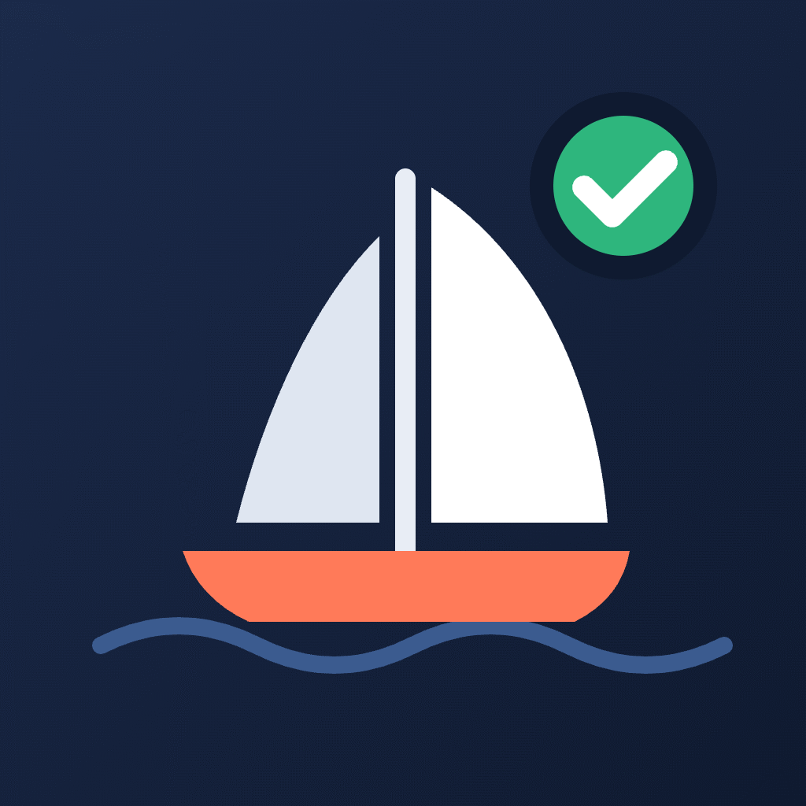

# argocd-slack-app



A Slack app for [Argo CD](https://argo-cd.readthedocs.io/) that posts **one
message per deploy and one message per incident**, then edits that message as
things change: syncing, rolling out, healthy or failed, degraded and
recovered. The thread keeps the timeline, so the channel stays readable.

It runs on AWS Lambda and reads each cluster's Argo CD Applications, pods and
events through the EKS API with a read-only access entry. It needs no changes
to Argo CD and no Argo CD notification triggers. Deploy it with
[terraform-aws-argocd-slack-app](https://github.com/cruxstack/terraform-aws-argocd-slack-app).

## Features

- **One message per event** - a deploy is one sync operation; an incident is
  one stretch of an app being unhealthy. Every later change edits the same
  message and adds a silent thread reply.
- **Quiet by default** - an incident opens only after an app stays Degraded,
  Missing or Unknown for 5 minutes (10 when the only cause is an HPA's metrics),
  flaps reopen the same message, and commits that don't change an app produce
  nothing.
- **Reasons, not just status** - crash loops with restart counts and exit
  codes, image pull and scheduling failures, failed PreSync jobs, HPA
  conditions and warning events. Optionally one redacted error line from the
  crashed container's log.
- **Deploy progress** - sync and rollout steps with pod counts, duration,
  commit, author, pull request and image.
- **Mute from Slack** - an app on one cluster, an app everywhere, a cluster or
  an environment, for an hour up to a week or until the app is healthy. From
  any message, a modal, `/argocd mute` or App Home.
- **Baseline and digest** - when a cluster joins, apps that are already failing
  are summarised in one message. A weekday digest lists anything unhealthy for
  more than a day.
- **Demo** - `/argocd demo` plays every message type in the current channel
  with made-up apps on a `demo` cluster: deploys that roll out, fail and get
  fixed, an incident that flaps and is muted, a baseline and a digest. Each
  message updates in place over about two minutes. `/argocd demo incident`
  plays one story.
- **Owner mentions** - optional, for incidents and failed deploys in
  environments named `prod`.
- **Durable** - state lives in DynamoDB, so restarts never repost or lose a
  message.
- **Web installer** - a setup page creates the Slack app from its manifest and
  installs it with OAuth, saving every credential to SSM.

## How it works

```text
EventBridge (every minute) ─▶ Lambda ─▶ EKS API (list, then watch for 55 s) per cluster
                                │  ├─▶ DynamoDB (app state, mutes, lease)
                                │  └─▶ Slack Web API (post, update, thread replies)
Slack (buttons, /argocd, App Home) ─▶ API Gateway ─▶ Lambda (signature checked)
Browser (/setup, OAuth install)    ─▶ API Gateway ─▶ Lambda ─▶ SSM Parameter Store
```

Each minute the Lambda takes a DynamoDB lease, lists every Application in each
enabled cluster and watches them until just before the next run, so changes
reach Slack within seconds. A state machine per app decides what to post:

- **Deploy**: syncing → rolling out → healthy, or sync failed, or unhealthy →
  recovered; stalled after 15 minutes; superseded by a newer sync. Degradation
  during a deploy, or up to 10 minutes after it, belongs to the deploy.
- **Incident**: healthy → pending (not posted) → open (posted once) → resolved
  (edited, with downtime). A recovery inside the grace period posts nothing.

Messages use the `plan` block for deploy steps and a collapsible `container`
for incident details. If Slack refuses either, the app falls back to section
and context blocks for the rest of the container's life.

## Configuration

The Lambda reads JSON from `ARGOCD_SLACK_CONFIG`. The Terraform module builds
it from a typed variable. A minimal config:

```json
{
  "channel": "C0123456789",
  "clusters": [
    {
      "name": "prod-use1",
      "env": "prod",
      "cluster": "prod-cluster",
      "role_arn": "arn:aws:iam::111122223333:role/prod-cluster-argocd-slack",
      "argocd_url": "https://argocd.prod.example.com",
      "enabled": true
    }
  ]
}
```

See [docs/configuration.md](docs/configuration.md) for every field: timing
rules, link templates, annotation names for commit metadata, SCM URLs, owners
and per-cluster settings. Other environment variables:

| Name                   | Value                                                          |
| ---------------------- | -------------------------------------------------------------- |
| `SLACK_BOT_TOKEN`      | SSM parameter ARN of the bot token                             |
| `SLACK_SIGNING_SECRET` | SSM parameter ARN of the signing secret                        |
| `SLACK_CLIENT_ID`      | SSM parameter ARN of the OAuth client ID (installer)           |
| `SLACK_CLIENT_SECRET`  | SSM parameter ARN of the OAuth client secret (installer)       |
| `SLACK_TEAM`           | SSM parameter ARN of the installed workspace (installer)       |
| `SSM_KMS_KEY_ID`       | KMS key for parameters the installer writes (default `aws/ssm`) |
| `TABLE_NAME`           | DynamoDB table with string keys `pk` and `sk`, TTL `ttl`       |
| `LOG_LEVEL`            | `info` (default) or `debug`                                    |

## Slack app

Turn on the installer (`"setup": {"enabled": true}`) for the first deploy and
open `https://<api-endpoint>/setup`. The page offers two ways to create the app:

- **Paste an app configuration token** (from
  [api.slack.com/apps](https://api.slack.com/apps) → *Your App Configuration
  Tokens*). The function creates the app from its manifest with every URL
  already filled in and saves the signing secret and OAuth client credentials.
  The token is used once and never stored.
- **Create it yourself** from a link that opens Slack's *Create app* dialog with
  the manifest prefilled, then paste the client ID, client secret and signing
  secret back into the page.

Then click **Install to Slack**. Slack's OAuth redirect brings the bot token
back to the function, which saves it with the workspace ID. Invite the bot to
its channels and turn the installer off.

Every credential goes to SSM Parameter Store, never to Terraform state or the
browser. The installer refuses to replace credentials once the app is
installed, and refuses an install into a different workspace. Its forms carry
a CSRF token, and the OAuth callback checks a state cookie.

To set the app up by hand instead, use
[docs/slack-app-manifest.yaml](docs/slack-app-manifest.yaml) and write the SSM
parameters yourself.

### Icon

[assets/icon.png](assets/icon.png) is the app's icon: a 1024×1024 PNG, inside
Slack's 512–2000 px square range, drawn from [assets/icon.svg](assets/icon.svg).
The installer sets it with `apps.icon.set` when you create the app with a
configuration token. Otherwise upload it under **Basic Information → Display
Information**; the setup page offers it as a download.

## Cluster access

Each cluster needs an IAM role the Lambda can assume, an EKS access entry for
it, and a read-only ClusterRole: get, list and watch on Applications; get and
list on pods, events, Deployments, ReplicaSets, StatefulSets, DaemonSets, Jobs,
HPAs and Rollouts; get on `pods/log` only where `log_lines` is on. The module's
`cluster-reader` submodule creates all of it. The Lambda must be able to reach
each cluster's API endpoint, for example through a VPC with private access or
PrivateLink.

## Development

```sh
make help        # list targets
make test        # tests with the race detector
make lint        # golangci-lint
make check       # everything CI runs
make demo-payloads  # every demo message as Block Kit Builder JSON in tmp/demo
```

`make test-live` runs one poll against a real cluster through `kubectl proxy`
and writes the messages it would send to a file. Nothing reaches Slack or AWS:

```sh
kubectl proxy --port 8099 &
LIVE_PROXY=http://127.0.0.1:8099 LIVE_OUT=/tmp/argocd-slack.json make test-live
```

## License

MIT
